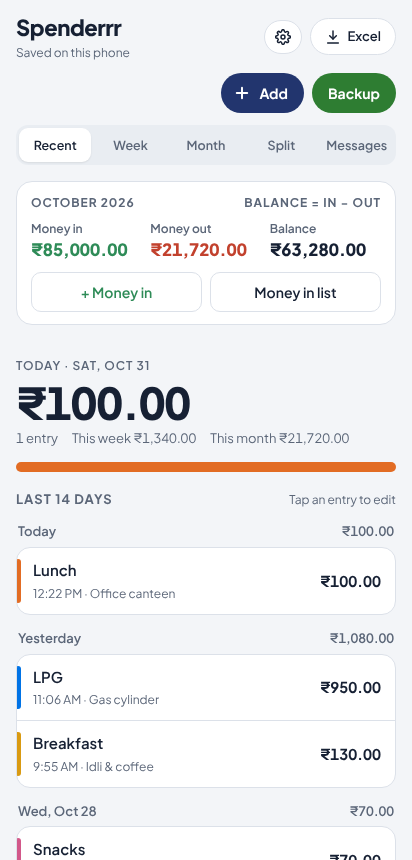
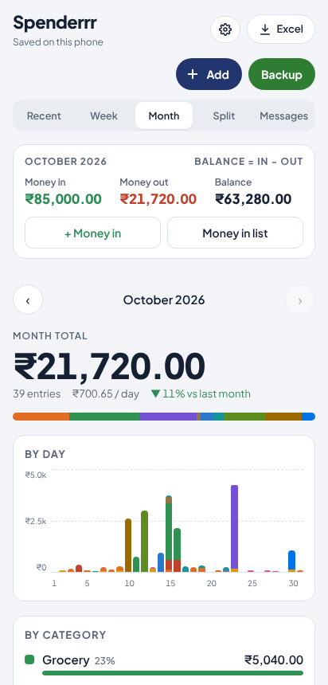
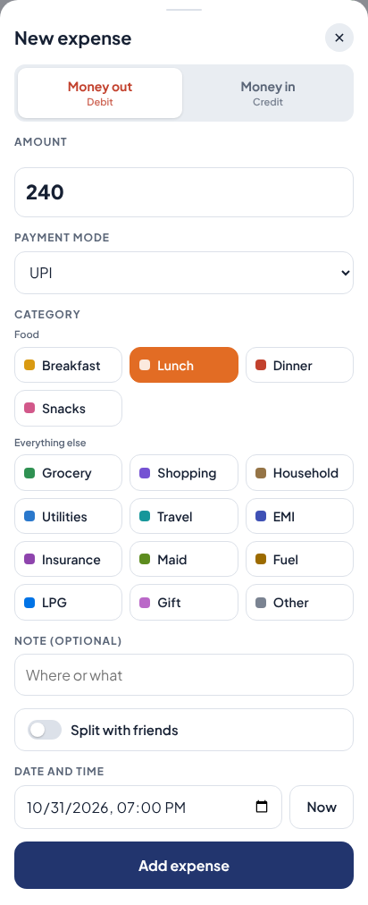
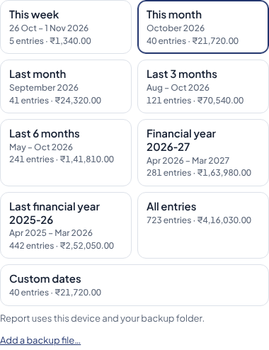
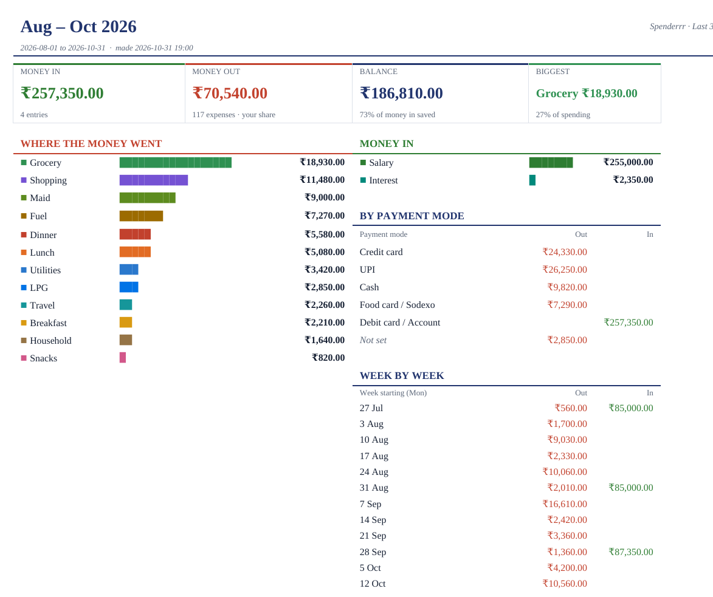

# Spenderrr

A fast, no-login expense tracker for phones: colour-coded categories, weekly and monthly totals,
Splitwise-style bill splitting, money in and out, payment modes, and Excel reports — with daily
backups to a folder or Google Drive. All data stays on the user's own device.

**Live app:** https://spend-log-v1.netlify.app — open it on a phone and choose *Add to Home Screen*.

<p>
  
  
  
</p>

## Features

- **Quick entry** — amount, payment mode, a colour-coded category (Breakfast, Lunch, Dinner, Snacks,
  Grocery, Shopping, Household, Utilities, Travel, EMI, Fuel, … plus your own), note, date and time.
- **Money in and out** — salary, interest, refunds and other income beside expenses, with a monthly balance.
- **Payment modes** — Credit card, UPI, Cash, Food card / Sodexo for money out; Cash, Debit card / Account for money in.
- **Views** — today, week, month (with by-day chart and comparison to last month).
- **Bill splitting** — split a bill with friends, track who owes whom, settle up, share a summary on WhatsApp.
- **Payment messages** — paste a bank or UPI message and the amount is read from it.
- **Bill reminders** — monthly, quarterly or yearly bills, added to the phone's calendar.
- **Excel reports** — this week, this month, last month, last 3 / 6 months, financial year, custom dates.
  The financial year follows the currency (India: April–March; US / Europe: January–December).
  Longer periods get one tab per month, newest first; each tab has a dashboard and every entry with
  filter buttons (category, payment mode, split, …).
- **Backup and restore** — a daily backup to a folder on the phone or computer and/or Google Drive,
  merged entry by entry so several devices never overwrite each other; restore on a new phone in two taps.
- **Works offline**, installs like an app, three currencies (₹, $, €).

<p>
  
  
</p>

## How it's built

| Area | Approach |
| --- | --- |
| App | A static Progressive Web App: HTML, CSS and plain JavaScript, no framework and no server |
| Storage | `localStorage` on the device; nothing is sent anywhere unless the user turns on Google Drive backup |
| Offline | Service worker, network-first so every device runs the same release |
| Backup | File System Access API (folder), Google Drive API with `drive.file` scope, share sheet on iPhone; three-way merge with deletion records so devices sync without losing entries |
| Excel | `.xlsx` files written directly as Office Open XML (styles, merged cells, filters, print titles), zipped in the browser |
| Security | Strict Content-Security-Policy with script hashes, no third-party scripts except Google sign-in, input checks on everything restored from a file |
| Hosting | Netlify; `develop` is production, `staging` is the test link |

| File | Purpose |
| --- | --- |
| `index.html` | The core app |
| `ledger.js` | Money in, your own categories, payment modes, monthly summary |
| `backup.js` | Backup, restore, device-to-device merge, Excel reports |
| `reminders.js` | Bill reminders and weekly / monthly report cards |
| `whatsapp.js` | WhatsApp summaries for split bills |
| `sw.js`, `manifest.webmanifest` | Offline support and install |
| `_headers` | Netlify security headers |
| `testCase/` | Automated tests |

## Tests

126 browser tests (Playwright) on Android, iPhone, small-phone and desktop screen sizes, with the clock
fixed and Google Drive simulated:

| Suite | Tests | Covers |
| --- | --- | --- |
| `testCase/run_tests.py` | 74 | Release checks, layout, backups, Drive, restore, merge rules, splitting, WhatsApp, Excel, offline updates |
| `testCase/test_reminders.py` | 22 | Bill reminders, calendar files, report cards |
| `testCase/test_reports.py` | 21 | Report periods, financial year by currency, month tabs, backups as a data source |
| `testCase/test_payment_mode.py` | 9 | Payment modes in forms, backup, merge and Excel |

```bash
pip install playwright openpyxl && python -m playwright install chromium
python3 testCase/run_tests.py            # or any other suite; add a word to run only matching tests
python3 testCase/make_report_samples.py  # sample Excel reports for every period
```

## Run locally

```bash
python3 -m http.server 8080    # then open http://localhost:8080
```

Releases are described in [docs/RELEASE.md](docs/RELEASE.md).

## What's next

Spenderrr v2 adds accounts (email/password and Google), sync across devices and shared split groups,
with a Java 21 / Spring Boot backend, PostgreSQL, Redis and Docker:
[docs/v2-architecture.md](docs/v2-architecture.md).

## License

Copyright © 2026 Saberi RS. All rights reserved. The source is public so it can be read and reviewed;
it may not be copied, modified or reused without written permission. See [LICENSE.txt](LICENSE.txt).
