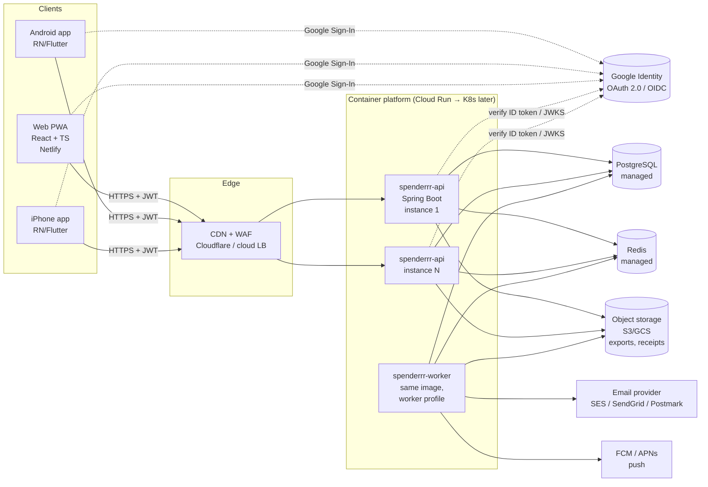
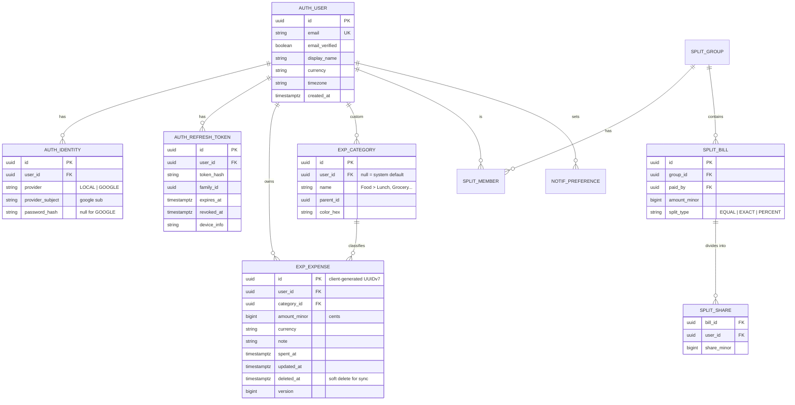
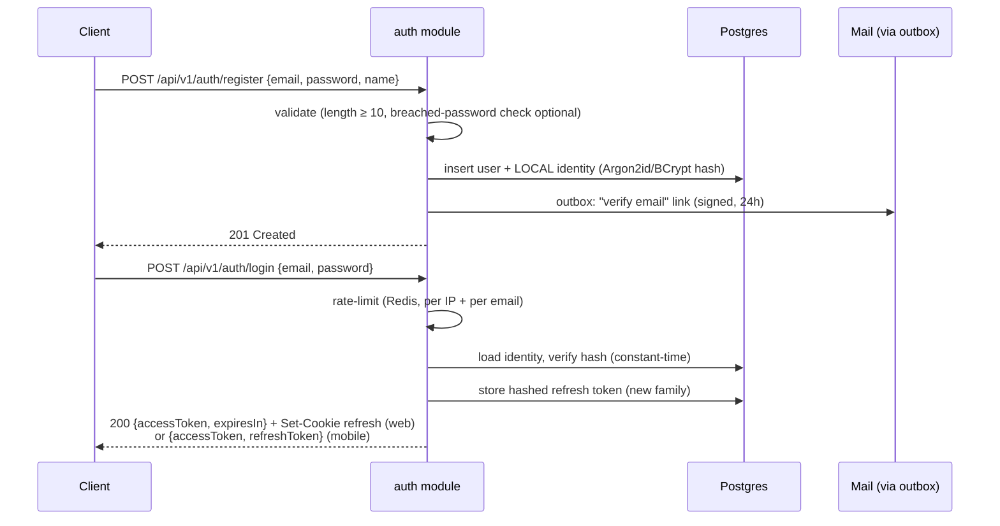
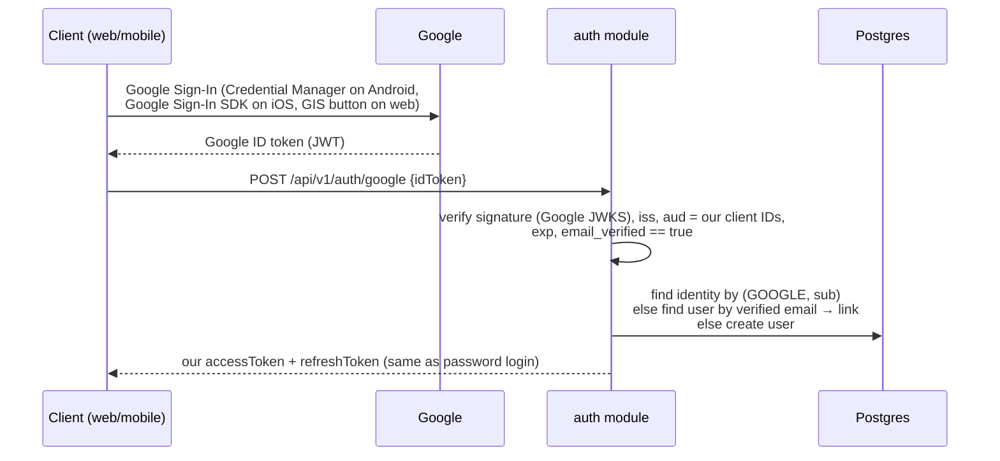

# Spenderrr v2 — Target Architecture Proposal

> **Goal:** move Spenderrr from a local-only web app (Netlify, browser storage) to a real multi-user app with **username/password + Google sign-in**, a **containerized, horizontally scalable backend**, and clients for **Web, Android and iPhone** — without losing the offline, fast-entry feel users already have.

Status: Proposal · Author: Saberi · Date: 2026-10-30 · Version target: `2027.01.1`

### Starting point → target

| Today (v1) | v2 target |
|---|---|
| Static web app on Netlify, no login | Same web app (PWA) on Netlify **+ Spring Boot API** in containers |
| Data in browser storage, daily folder backup, optional Drive backup | Local DB on device **synced to Postgres**; backups kept as an extra safety net |
| Bill splitting computed on one device | Split groups shared between real users, server-authoritative balances |
| Android/iPhone via browser | Browser PWA + native Android (Play Store) + iPhone apps |
| No email | Weekly/monthly report emails + bill reminders (opt-in) |
| Branches: `staging` = test link, `develop` = production | Same branches drive backend staging/prod deploys |

**Guest mode stays.** The app keeps working without an account exactly like v1 (local-only). Signing in with username/password or Google is **optional** and unlocks sync across devices, shared bill splitting, and email reports. On first sign-in the app uploads the guest data (see §7). This avoids breaking current users and keeps the "no signup to start" hook that helps growth.

---

## 1. TL;DR — the recommendation

| Layer | Choice | Why |
|---|---|---|
| Architecture style | **Modular monolith** (one deployable, strict internal modules) → split into services only when a module needs it | Microservices on day one = 5× ops cost for a 1-person team. A modular monolith scales horizontally just as well when it's stateless. |
| Backend | **Java 21 LTS + Spring Boot 3.x**, Spring Security, Spring Data JPA, Flyway | Mature, well-supported stack; best-in-class security and ecosystem. |
| Auth | **Own auth module** issuing short-lived **JWT access tokens + rotating refresh tokens**; local accounts (BCrypt/Argon2) + **Google Sign-In** (ID-token verification) | Full control, no per-user auth fees, works identically for web and mobile. Keycloak is the "buy" alternative (see §5.5). |
| Database | **PostgreSQL 16+** | Relational data (users, expenses, groups, splits), strong consistency for money, JSONB when you need flexibility. |
| Cache / rate-limit / locks | **Redis** | Token blacklist, rate limiting, ShedLock for schedulers, hot report cache. |
| Async jobs | DB **outbox table** + scheduled workers (later: RabbitMQ / SQS) | Weekly/monthly emails, bill reminders, exports — reliable without a broker on day one. |
| Clients | Web: keep current app → evolve into **PWA (React + TypeScript)**. Mobile: **React Native (Expo)** *or* **Flutter** | One codebase for Android + iPhone; offline-first local DB that syncs. |
| Containers | **Docker** (multi-stage, distroless/JRE image), **docker-compose** locally | Same image runs locally, in staging and in prod. |
| Hosting (phase 1) | **Managed container platform** (Google Cloud Run / AWS App Runner / Render / Fly.io) + **managed Postgres** | Autoscaling, HTTPS, zero cluster management. |
| Hosting (phase 3) | **Kubernetes** (GKE/EKS) with Helm, HPA | Only when traffic or team size justifies it. |
| CI/CD | **GitHub Actions** → build, test, scan, push image → deploy `staging` → manual promote to `prod` | Matches the existing `staging` / `develop` branch flow. |
| Observability | Micrometer + **OpenTelemetry**, Prometheus/Grafana (or Grafana Cloud), structured JSON logs | Know when something breaks before users tell you. |

---

## 2. Big picture



**Key property:** the API is **stateless** (no HTTP session; JWT carries identity). Any instance can serve any request → add instances to scale. All state lives in Postgres/Redis/object storage.

The **worker** is the *same Docker image* started with `SPRING_PROFILES_ACTIVE=worker` — it runs schedulers and outbox processing, not HTTP traffic. One codebase, two run modes.

---

## 3. Backend: modular monolith layout

```
spenderrr-backend/
├── build.gradle.kts
├── Dockerfile
├── docker-compose.yml
├── src/main/java/com/spenderrr/
│   ├── SpenderrrApplication.java
│   ├── shared/            # common: errors, Money type, clock, ids, outbox
│   ├── auth/              # register, login, Google, tokens, password reset
│   │   ├── api/           # controllers + DTOs (public surface)
│   │   ├── application/   # use cases / services
│   │   ├── domain/        # User, Credential, RefreshToken
│   │   └── infra/         # JPA repos, Google verifier, mail adapter
│   ├── expense/           # expenses, categories, budgets
│   ├── split/             # groups, shared bills, balances, settle-up
│   ├── report/            # weekly/monthly aggregates, Excel export
│   ├── notification/      # email/push preferences, bill reminders
│   └── sync/              # offline sync endpoint (changes since cursor)
└── src/main/resources/
    ├── application.yml
    ├── application-local.yml / -staging.yml / -prod.yml
    └── db/migration/      # Flyway V1__init.sql, V2__..., ...
```

**Rules that keep it a *modular* monolith (and splittable later):**

1. Modules talk to each other only through their `api`/`application` interfaces or **domain events** — never another module's repository or entity.
2. Each module owns its tables (prefix them: `auth_user`, `exp_expense`, `split_group`…). No cross-module joins in code; reporting reads via views or its own read model.
3. Enforce with **Spring Modulith** (`ApplicationModules.of(...).verify()` in a unit test) or **ArchUnit**. The build fails if a boundary is crossed.
4. Cross-module side effects go through `@ApplicationModuleListener` / `ApplicationEventPublisher` + the outbox → easy to replace with a real broker later.

**When to extract a service:** a module has a clearly different scaling profile (e.g. `report` doing heavy Excel generation) or a different release cadence. Extract it by moving the package to a new repo, replacing in-process events with a broker. Because boundaries are enforced from day one, this is a refactor, not a rewrite.

---

## 4. Data model (core)



Design notes:

- **Money as `bigint` minor units** (cents/paise) + currency code. Never `double`. In Java use a `Money` value object (or `javax.money` / Moneta).
- **Client-generated UUIDv7 IDs** → mobile can create expenses offline and sync later without ID collisions; v7 is time-ordered so B-tree indexes stay efficient.
- **`updated_at` + `deleted_at` + `version`** on synced tables → enables delta sync and optimistic locking (`@Version`).
- One user can have **multiple identities** (LOCAL + GOOGLE) → "Sign in with Google" on an account originally created with a password links instead of duplicating.
- Indexes: `exp_expense (user_id, spent_at DESC)`, `exp_expense (user_id, updated_at)` for sync, partial index `WHERE deleted_at IS NULL`.
- Later scaling: partition `exp_expense` by `spent_at` (monthly/yearly) once it reaches tens of millions of rows.

---

## 5. Authentication & authorization

### 5.1 Token model

| Token | Lifetime | Stored where (client) | Notes |
|---|---|---|---|
| **Access token** (JWT, signed **RS256/ES256**) | 10–15 min | Memory (web), secure storage (mobile) | Claims: `sub` (user id), `iat`, `exp`, `scope`, `jti`. No PII beyond what's needed. |
| **Refresh token** (opaque random 256-bit) | 30–90 days | Web: **HttpOnly, Secure, SameSite=Strict cookie**. Mobile: Keychain / Android Keystore | Stored **hashed** server-side. **Rotated on every use**; reuse of an old one revokes the whole family (theft detection). |

Publish the public key at `/.well-known/jwks.json` so future services can verify tokens without calling the auth module. Rotate signing keys with a `kid` header.

### 5.2 Username / password flow



Also: `POST /auth/refresh`, `POST /auth/logout` (revoke family), `POST /auth/password/forgot` + `/reset` (single-use token, 30 min), `POST /auth/email/verify`, `GET /me`, `DELETE /me` (**account deletion is required by Google Play and Apple App Store**).

Password hashing: Spring Security `Argon2PasswordEncoder` (preferred) or `BCryptPasswordEncoder(12)` via `DelegatingPasswordEncoder` so it can be upgraded later.

### 5.3 Google sign-in flow (web + Android + iPhone)

The **"ID token exchange"** pattern — the client does the Google UI natively, the backend verifies and issues *its own* tokens:



Java side: `GoogleIdTokenVerifier` with `setAudience(List.of(webClientId, androidClientId, iosClientId))`, or Spring's `NimbusJwtDecoder.withJwkSetUri("https://www.googleapis.com/oauth2/v3/certs")` plus issuer/audience validators. "Sign in with Apple" is added for the iPhone app (App Store rule when other social logins are offered).

### 5.4 Spring Security configuration sketch

```java
@Configuration
@EnableMethodSecurity
class SecurityConfig {

  @Bean
  SecurityFilterChain api(HttpSecurity http) throws Exception {
    return http
      .csrf(csrf -> csrf.ignoringRequestMatchers("/api/**")) // bearer tokens; refresh cookie is SameSite=Strict
      .cors(Customizer.withDefaults())
      .sessionManagement(s -> s.sessionCreationPolicy(SessionCreationPolicy.STATELESS))
      .authorizeHttpRequests(auth -> auth
          .requestMatchers("/api/v1/auth/**", "/.well-known/**", "/actuator/health/**").permitAll()
          .anyRequest().authenticated())
      .oauth2ResourceServer(o -> o.jwt(Customizer.withDefaults())) // validates our own JWTs via JWKS/public key
      .headers(h -> h.contentSecurityPolicy(c -> c.policyDirectives("default-src 'none'")))
      .build();
  }

  @Bean
  PasswordEncoder passwordEncoder() {
    return PasswordEncoderFactories.createDelegatingPasswordEncoder(); // argon2/bcrypt upgradeable
  }
}
```

**Authorization:** every query is scoped by the authenticated user — `expenseRepo.findByIdAndUserId(id, currentUserId())`. Never trust a `userId` from the request body. For split groups, check membership (`@PreAuthorize("@groupAuth.isMember(#groupId)")`). This prevents IDOR, the #1 bug in apps like this.

### 5.5 Build vs. buy for auth

| Option | Pros | Cons | Verdict |
|---|---|---|---|
| **Own auth module (above)** | Full control, no vendor fee, one deployable | We own password reset, rate limiting, key rotation | ✅ **Chosen** for Spenderrr's scope |
| **Keycloak** (self-hosted container) | Battle-tested, MFA, social login, admin UI | Another heavy container to run/upgrade; overkill for one app | Good with multiple apps |
| **Spring Authorization Server** | Standards-compliant OAuth2/OIDC provider in Java | More protocol surface than needed now | If a public API opens to third parties |
| **Managed (Firebase Auth, Auth0, Cognito, Supabase)** | Fastest to ship, MFA included | Vendor lock-in, per-MAU pricing, user table elsewhere | Fine for a prototype |

---

## 6. API design

REST + JSON, versioned under `/api/v1`, documented with **springdoc-openapi** (Swagger UI in non-prod). TypeScript/Dart clients are generated from the OpenAPI spec so clients never drift.

```
POST   /api/v1/auth/register | /login | /google | /refresh | /logout
GET    /api/v1/me                        DELETE /api/v1/me
GET    /api/v1/categories                POST   /api/v1/categories
GET    /api/v1/expenses?from=&to=&category=&cursor=
POST   /api/v1/expenses                  (Idempotency-Key header)
PATCH  /api/v1/expenses/{id}             (If-Match: version)
DELETE /api/v1/expenses/{id}             (soft delete)
GET    /api/v1/reports/summary?period=WEEK|MONTH&date=
POST   /api/v1/reports/export            → 202 + job id → signed download URL (xlsx)
GET    /api/v1/sync?since=<cursor>       POST /api/v1/sync  (batch push)
GET    /api/v1/groups  POST /api/v1/groups/{id}/bills  GET /api/v1/groups/{id}/balances
PUT    /api/v1/notifications/preferences
```

Conventions: errors as **RFC 9457 Problem Details** (`ProblemDetail` is built into Spring 6), cursor pagination, `Idempotency-Key` on creates (mobile retries on flaky networks), ISO-8601 UTC timestamps + user timezone for reports.

---

## 7. Offline-first sync (keep the "instant entry" feel)

1. Clients keep a **local DB** (web: IndexedDB via Dexie; mobile: SQLite). UI always reads/writes local first.
2. Each change is queued; a background sync does `POST /sync` (push batch) then `GET /sync?since=cursor` (pull changes, including tombstones).
3. **Conflict rule:** last-writer-wins on `updated_at` per record (fine for personal expenses); for split bills, the server is authoritative and returns the merged state.
4. **Guest users** skip steps 2–3 entirely — the local DB is the only store, same as v1 today.
5. **Migration of existing users:** on first login, the app offers *"Upload my existing expenses"* → reads current browser storage/backup file → pushes via `/sync`. Server dedupes by client UUID.

---

## 8. Background jobs, emails & reminders

- **Outbox pattern:** in the same DB transaction that changes state, insert a row into `outbox_event`. The worker polls (`SELECT … FOR UPDATE SKIP LOCKED`), sends, marks done, retries with backoff. No lost emails, no broker needed at first.
- **Schedulers** (`@Scheduled` + **ShedLock** so only one instance runs each job): weekly report (Mondays, per user timezone), monthly report (1st of month), bill reminders (daily scan → email + push).
- **Excel export:** Apache POI **SXSSF** (streaming) in the worker, upload to object storage, return a short-lived signed URL.
- One-click unsubscribe link in every email; opt-in preferences respected.
- **Upgrade path:** publish outbox events to **RabbitMQ / AWS SQS / Kafka** with dedicated consumers when volume grows.

---

## 9. Containerization

### 9.1 Dockerfile (multi-stage, small, non-root)

```dockerfile
# ---- build ----
FROM eclipse-temurin:21-jdk AS build
WORKDIR /app
COPY gradlew settings.gradle.kts build.gradle.kts ./
COPY gradle ./gradle
RUN ./gradlew dependencies --no-daemon > /dev/null
COPY src ./src
RUN ./gradlew bootJar --no-daemon -x test \
 && java -Djarmode=tools -jar build/libs/*.jar extract --layers --launcher --destination extracted

# ---- runtime ----
FROM eclipse-temurin:21-jre
RUN useradd -r -u 1001 spenderrr
WORKDIR /app
COPY --from=build /app/extracted/dependencies/ ./
COPY --from=build /app/extracted/spring-boot-loader/ ./
COPY --from=build /app/extracted/snapshot-dependencies/ ./
COPY --from=build /app/extracted/application/ ./
USER 1001
EXPOSE 8080
ENV JAVA_TOOL_OPTIONS="-XX:MaxRAMPercentage=75 -XX:+ExitOnOutOfMemoryError"
ENTRYPOINT ["java", "org.springframework.boot.loader.launch.JarLauncher"]
```

### 9.2 Local development

`docker compose up` starts the API, the worker (same image, `worker` profile), Postgres 16, Redis 7 and Mailpit (catches all emails locally). Integration tests use **Testcontainers** (`@ServiceConnection`) against real Postgres/Redis.

### 9.3 Twelve-factor rules

- All config from env vars / secret manager — **no secrets in Git** (Google client secret, JWT private key, DB password).
- Health probes: `/actuator/health/liveness` and `/actuator/health/readiness`.
- Graceful shutdown: `server.shutdown=graceful`.
- Logs to stdout as JSON.

---

## 10. Scaling path

| Stage | Users (rough) | Setup |
|---|---|---|
| **1 — Launch** | 0 → ~10k | 1–3 API instances (autoscale) + 1 worker on Cloud Run/App Runner; managed Postgres with automated backups + PITR; managed Redis; CDN in front of web. |
| **2 — Growth** | ~10k → ~200k | Postgres **read replica** for reports; HikariCP tuned (`maximumPoolSize` × instances < DB max connections, or **PgBouncer**); cached report aggregates; pre-aggregated daily totals. |
| **3 — Scale** | 200k+ | **Kubernetes** (Helm, HPA on CPU/RPS, PodDisruptionBudgets); extract `report`/`notification` into services consuming a broker; partition `exp_expense`. |

A stateless API plus DB connection discipline is what actually lets it scale; Kubernetes is just a different place to run the same image.

---

## 11. Environments & CI/CD

| Branch | Environment | Deploy |
|---|---|---|
| `feature/*` | PR preview (optional) | On PR |
| `staging` | **staging** (own DB, own Google OAuth client, test email domain) | Auto on merge |
| `develop` | **production** | Manual approval in GitHub Actions after staging is green |

Pipeline:

1. `./gradlew test` (unit + Testcontainers integration + Spring Modulith/ArchUnit boundary test)
2. Static analysis: SpotBugs/Error Prone, Dependabot, CodeQL
3. Build image → scan with **Trivy** → push to registry, tagged `YYYY.MM.N` + git SHA
4. Deploy to staging → smoke tests (register, login, add expense, Google token with a test account)
5. Manual approval → deploy the same image digest to prod
6. Flyway migrations always **backward-compatible** (expand → migrate → contract) so old and new versions run side by side during rollout.

---

## 12. Security checklist

- [ ] HTTPS everywhere; HSTS
- [ ] Argon2id/BCrypt passwords; never log passwords or tokens
- [ ] Rate limiting on `/auth/*` (Bucket4j + Redis) and account lockout with backoff
- [ ] Refresh-token rotation + reuse detection; revoke on password change
- [ ] Google ID token: verify signature, `iss`, `aud`, `exp`, `email_verified`
- [ ] Every data query scoped by `user_id` (IDOR tests per endpoint)
- [ ] Input validation (`@Valid`, Bean Validation), max sizes
- [ ] CORS allow-list: only our web origins
- [ ] Secrets in a secret manager; JWT signing key rotation with `kid`
- [ ] Encrypted DB at rest + automated backups; a tested restore
- [ ] Privacy policy, data export & **account deletion** (store requirements)
- [ ] Audit log for auth events (login, failed login, password reset, token reuse)

---

## 13. Observability

- **Metrics:** Micrometer → Prometheus/Grafana. Dashboards: RPS, p95 latency, error rate, DB pool usage, JVM memory/GC, outbox backlog.
- **Tracing:** OpenTelemetry (Micrometer Tracing bridge) → Tempo/Jaeger.
- **Logs:** JSON with `traceId` and hashed `userId`.
- **Alerts:** 5xx rate, p95 > 500 ms, growing outbox backlog, failed scheduled jobs, DB connections > 80%.
- **Client crash reporting:** Sentry or Firebase Crashlytics.

---

## 14. Phased roadmap

| Phase | Scope | Outcome |
|---|---|---|
| **0. Foundations** | Backend repo, Spring Boot skeleton, Flyway, docker-compose, CI, Spring Modulith test | `docker compose up` gives a running API locally |
| **1. Auth** | Register/login/refresh/logout, email verify, password reset, Google sign-in, `/me`, delete account | Users can sign in on web with both methods |
| **2. Core expenses** | Categories, expenses CRUD, weekly/monthly summary, Excel export | Feature parity with v1, server-side |
| **3. Sync + migration** | `/sync`, web client local DB, "upload my existing data" | Existing users move over without losing data |
| **4. Deploy** | Staging + prod on managed containers, managed Postgres/Redis, monitoring, backups | Public beta |
| **5. Mobile** | RN/Flutter app, Google + Apple sign-in, offline sync, push | Play Store, then App Store |
| **6. Social & notifications** | Split groups/bills/balances, weekly/monthly emails, bill reminders | Full v2 |
| **7. Scale & monetize** | Read replica, caching, premium tier with server-side entitlement checks | Revenue |
